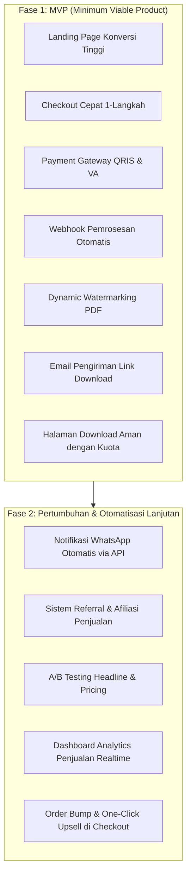

# 01 - Product Requirements Document (PRD)
## Produk: Website Penjualan Ebook "The Prompt - Seni Berbicara dengan AI"

---

## 1. Ringkasan Eksekutif (Executive Summary)

**"The Prompt - Seni Berbicara Dengan AI"** karya **Budhi Prasetyo** (Bogor, 2026) adalah buku digital komprehensif setebal **400+ halaman** yang terbagi dalam **5 Bagian dan 20 Bab**. Buku ini memandu pembaca menguasai **Kerangka PKIF (Peran, Konteks, Instruksi, Format)** untuk mengubah AI dari sekadar chatbot pencari jawaban biasa menjadi mitra kerja strategis yang cerdas dan berdaya guna tinggi.

Tujuan dari proyek ini adalah membangun platform web penjualan mandiri (*Direct-to-Consumer / D2C*) yang memiliki konversi tinggi, otomatisasi pengiriman instan, integrasi sistem pembayaran Indonesia via Midtrans Snap (QRIS, VA, E-Wallet), serta sistem perlindungan hak cipta digital (dynamic PDF watermarking).

---

## 2. Latar Belakang & Masalah (Problem Statement)

### 2.1 Masalah di Sisi Konsumen
1. **Tingginya Adopsi vs Rendahnya Literasi:** Indonesia adalah pengguna AI terbesar ke-3 di dunia dengan 84% pengguna internet pernah mencoba AI. Namun, indeks literasi AI masyarakat Indonesia baru menyentuh angka **49,9 dari 100 (kategori rendah)**. Masyarakat sudah masuk ke kolam renang tapi baru bisa mengapung, belum bisa berenang.
2. **Memperlakukan AI seperti Mesin Pencari:** Pengguna mengetikkan instruksi pendek asal-asalan layaknya mengetik kata kunci di Google, sehingga output yang dihasilkan generik, hambar, atau berhalusinasi.
3. **Ketiadaan Kerangka Berpikir Teruji:** Belum adanya buku berbahasa Indonesia yang menyajikan kerangka sistematis yang universal untuk segala jenis AI. "The Prompt" hadir menjawab gap ini melalui Kerangka PKIF.

### 2.2 Masalah di Sisi Penjual (Merchant)
1. **Potongan Marketplace Tinggi:** Platform pihak ketiga mengenakan fee 10-20% per transaksi.
2. **Keterbatasan Database Pelanggan:** Marketplace tidak memberikan akses langsung ke daftar email dan nomor kontak pembeli untuk kepentingan *retargeting* atau produk berikutnya.
3. **Risiko Pembajakan Ebook:** File PDF konvensional mudah dibagikan ulang secara bebas di grup Telegram/WhatsApp tanpa identitas pembeli.

---

## 3. Target Pasar & Profil Pengguna (User Persona)

| Parameter | Persona 1: Profesional & Pekerja Kantoran | Persona 2: Kreator Konten & Marketer | Persona 3: Mahasiswa / Freelancer Pemula |
|---|---|---|---|
| **Nama Representatif** | Budi (32 th, Digital Project Manager) | Sinta (26 th, Social Media Specialist) | Rizky (21 th, Mahasiswa Sistem Informasi) |
| **Pain Point** | Waktu tersita untuk meeting dan drafting dokumen; butuh AI untuk otomatisasi kerja 3x lebih cepat. | Kehabisan ide konten; prompt gambar/copywriting sering kali hambar dan tidak menarik. | Ingin portofolio cepat selesai; butuh bimbingan terstruktur dengan harga terjangkau. |
| **Ekspektasi** | Framework siap pakai (bukan sekadar teori), cheatsheet cepat dibuka di meja kerja. | Template prompt copywriting, prompt visual Midjourney, dan studi kasus campaign viral. | Bahasa santai, mudah dipraktikkan langsung, dan bonus prompt bank. |
| **Metode Pembayaran Pilihan** | Virtual Account Bank (BCA/Mandiri) / Credit Card | QRIS / GoPay / ShopeePay | QRIS / DANA / OVO |

---

## 4. Paket Produk & Strategi Harga (Product Packaging)

Untuk memaksimalkan *Average Order Value (AOV)*, produk ditawarkan dalam 3 tingkatan (tiers):

| Komponen | Paket Starter (Dasar) | Paket Pro (Paling Populer) | Paket Complete / VIP Bundle |
|---|---|---|---|
| **Target Harga (Coret/Promo)** | ~Rp 149.000~ → **Rp 99.000** | ~Rp 299.000~ → **Rp 179.000** | ~Rp 499.000~ → **Rp 279.000** |
| **Format Utama** | Ebook PDF Lengkap 400+ Hlm (20 Bab) | PDF & ePub Edisi Lengkap (400+ Hlm) | PDF, ePub, & Audio Summary MP3 |
| **Bank Prompt Siap Pakai** | Latihan "Coba Sekarang" 20 Bab | 82+ Template Prompt Siap Pakai (Bab 14-18) | 82+ Template + Notion AI Command Center |
| **Cheatsheet & Template** | ❌ | Printable Cheatsheet Rumus PKIF (A4 PDF) | Cheatsheet + 12 Prinsip Etika AI (Bab 20) |
| **Update Konten** | Versi rilis saat ini | Gratis update selamanya (Life-time updates) | Gratis update selamanya + Akses Komunitas Eksklusif |

---

## 5. Ruang Lingkup Fitur (Feature Scope)

### 5.1 Kebutuhan Fungsional (Functional Requirements)

#### A. Sisi Pengunjung / Pembeli (Public & Customer Area)
1. **Landing Page Persuasif:**
   - Hero section dengan Headline kuat, Sub-headline, CTA utama, dan visual mock-up 3D ebook.
   - Social proof (kutipan pakar industri, testimoni awal pembaca preview).
   - "Daftar Isi Lengkap & Sneak Peek" interaktif.
   - Perbandingan paket harga (*Pricing Table*) dengan badge "Paling Populer".
   - Accordion FAQ mengatasi keraguan (Metode bayar, garansi uang kembali, format file).
   - Sticky CTA Bar pada perangkat mobile.

2. **Proses Checkout Instan:**
   - Form checkout minimalis: Nama Lengkap, Alamat Email (validasi ganda untuk mencegah typo), dan Nomor WhatsApp.
   - Pilihan paket langsung di dalam modal atau step checkout.
   - Opsi *Order Bump* (misal: "Tambah Rp 39.000 untuk Audiobook ringkasan").

3. **Pembayaran & Verifikasi Otomatis:**
   - Integrasi Payment Gateway lokal (Midtrans Snap / Xendit).
   - Mendukung QRIS (GoPay, OVO, ShopeePay, DANA, BCA Mobile), Virtual Account bank-bank utama, dan Kartu Kredit.
   - Webhook callback yang memproses status `SETTLED` / `CAPTURE` secara instan (< 3 detik).

4. **Sistem Pengiriman & Download:**
   - Pengiriman email otomatis berisi tombol akses dan tanda terima resmi.
   - Halaman "Terima Kasih / Download Portal" unik dengan token aman (Signed URL).
   - Pembatasan unduhan (misal: maksimal 5 kali unduhan per transaksi untuk mencegah tautan disebarkan).
   - Proteksi Watermark Otomatis: Setiap halaman PDF dibubuhkan teks transparan: *"Dilisensikan khusus untuk: [Nama Pembeli] | [Email] | Order: #TRX-XXXX"*.

#### B. Sisi Pengelola / Admin
1. **Dashboard Manajemen Pesanan:**
   - Melihat daftar transaksi (Pending, Sukses, Gagal, Expired).
   - Fitur kirim ulang email unduhan (*Resend Download Link*) dengan 1 tombol jika pelanggan salah ketik email.
   - Rekap omzet harian, mingguan, bulanan, serta konversi rasio per paket.
2. **Katalog & Konfigurasi Produk:**
   - Update harga, diskon, dan status stok bonus.
   - Upload versi revisi file master Ebook.

---

## 6. Kebutuhan Non-Fungsional (Non-Functional Requirements)

1. **Kecepatan & Performa (Web Vitals):**
   - Largest Contentful Paint (LCP) < 1.5 detik pada koneksi 4G mobile.
   - Cumulative Layout Shift (CLS) = 0.
   - Total blocking time (TBT) < 100ms.
2. **Keamanan (Security & Data Protection):**
   - File master PDF disimpan di private object storage (Cloudflare R2 / AWS S3) tanpa akses publik langsung.
   - Token unduhan menggunakan HMAC SHA256 berbatas waktu (Time-to-Live 24-48 jam per link).
   - Verifikasi ketat *Signature Key* pada Webhook payment gateway untuk menghindari transaksi fiktif (*spoofing*).
   - Enkripsi HTTPS/TLS 1.3 menyeluruh.
3. **Responsivitas & Kompatibilitas:**
   - 100% responsif dengan fokus utama *Mobile First* (estimasi > 75% traffic dari media sosial seperti X/Twitter, Instagram, TikTok, LinkedIn).
4. **Reliabilitas:**
   - Ketersediaan sistem minimal 99.9%.
   - Queue/antrean terpisah untuk proses watermarking PDF dan pengiriman email agar respons checkout tidak terhambat (*non-blocking asynchronous job*).

---

## 7. Indikator Keberhasilan & Metrik (Key Performance Indicators)

| Metrik | Target Awal (Bulan 1 Peluncuran) | Cara Mengukur |
|---|---|---|
| **Conversion Rate (Visitor to Buyer)** | > 2.5% | Google Analytics 4 / PostHog Funnel Tracking |
| **Checkout Completion Rate** | > 65% (dari yang membuka form checkout) | Event: `checkout_initiated` vs `purchase_success` |
| **Kecepatan Pengiriman Ebook** | < 10 detik sejak pembayaran lunas | Server log timestamp webhook vs timestamp email sent |
| **Tingkat Komplain Gagal Terima File** | < 1% dari total transaksi | Tiket bantuan / Pesan WhatsApp CS |
| **Average Order Value (AOV)** | Rp 160.000+ (terdorong paket Pro/VIP) | Total Revenue / Total Orders |
