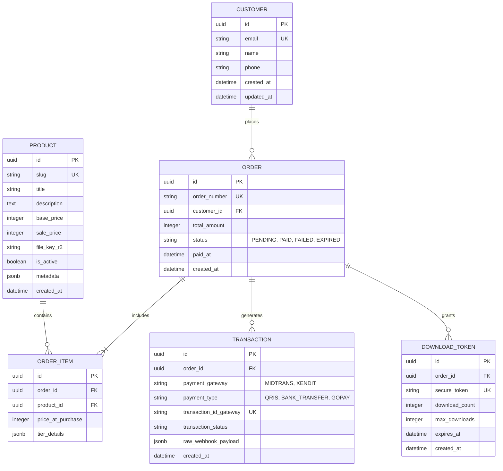
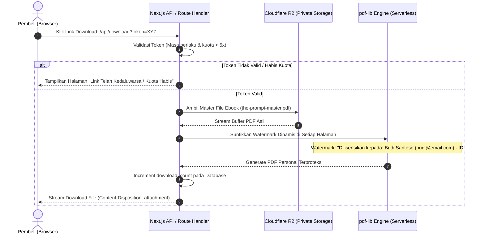

# 02 - Arsitektur Sistem & Spesifikasi Tech Stack
## Produk: Platform E-Commerce Digital "The Prompt - Seni Berbicara dengan AI"

---

## 1. Arsitektur Tingkat Tinggi (High-Level Architecture)

Arsitektur aplikasi dirancang menggunakan pola **Jamstack / Serverless Modern** yang mengutamakan performa loading super cepat, biaya operasional murah (*zero-egress cost*), skalabilitas instan saat terjadi lonjakan traffic (*traffic spike*), serta keamanan aset digital tingkat tinggi.

```mermaid
flowchart TB
    subgraph Client ["Client Browser / Mobile Visitor"]
        UI[Landing Page & 1-Click Checkout]
        SnapModal[Midtrans Snap / Payment Popup]
    end

    subgraph EdgeNetwork ["Edge & CDN (Vercel / Cloudflare)"]
        CDN[Edge Caching & Static Assets]
        AppRouter[Next.js 15 App Router / Server Actions]
    end

    subgraph DatabaseLayer ["Database & Auth"]
        DB[(PostgreSQL via Supabase / Neon)]
        Prisma[Prisma ORM / Drizzle]
    end

    subgraph StorageLayer ["Encrypted Storage"]
        R2[Cloudflare R2 Object Storage<br/>(Master PDF & Assets - No Public Access)]
    end

    subgraph ExternalServices ["Third-Party External Services"]
        PG[Midtrans / Xendit Gateway]
        EmailService[Resend API<br/>Transactional Email]
        WAService[WhatsApp Cloud API / Fonnte / Waha]
    end

    UI -->|1. Akses Landing Page| CDN
    CDN -->|SSG / ISR Content| UI
    UI -->|2. Submit Form Order| AppRouter
    AppRouter -->|3. Buat Invoice / Snap Token| PG
    PG -->|4. Return Token| SnapModal
    SnapModal -->|5. Bayar QRIS / VA| PG
    PG -->|6. Webhook Notification POST| AppRouter
    AppRouter -->|7. Verifikasi Signature & Update Status| Prisma
    Prisma -->|Simpan Record| DB
    AppRouter -->|8. Fetch Master PDF & Watermark| R2
    AppRouter -->|9. Trigger Email Akses Download| EmailService
    AppRouter -.->|10. Opsi Notifikasi WA| WAService
    EmailService -->|11. Kirim Email + Signed URL| Client
```

---

## 2. Pemilihan Teknologi (Tech Stack Rationale)

| Komponen | Pilihan Teknologi | Alasan & Keuntungan Teknis |
|---|---|---|
| **Framework Web** | **Next.js 15 (App Router)** | Rendering hibrida (SSG untuk landing page statis berkecepatan tinggi, Server Actions untuk transaksi aman tanpa expose API key). |
| **Styling & UI** | **Tailwind CSS + Lucide Icons + Framer Motion** | Desain fleksibel, ukuran bundle CSS sangat kecil (< 15KB terkompresi), animasi transisi halus yang meningkatkan konversi. |
| **Database** | **PostgreSQL (Supabase atau Neon)** | Relasional, kuat dalam menjaga integritas data transaksi keuangan, dukungan JSONB untuk metadata fleksibel, free-tier memadai. |
| **ORM / Data Access** | **Prisma ORM** | Type-safe query, migrasi skema deklaratif, meminimalkan bug tipe data saat berinteraksi dengan database. |
| **File Storage** | **Cloudflare R2** | Kompatibel dengan API S3 AWS, **tanpa biaya egress bandwidth** (sangat hemat saat ribuan ebook diunduh), enkripsi otomatis *at-rest*. |
| **PDF Processing** | **`pdf-lib` (Node.js)** | Library JavaScript murni tanpa ketergantungan native C++ binary, dapat berjalan cepat di Vercel Serverless Functions untuk *dynamic watermarking*. |
| **Payment Gateway** | **Midtrans (Snap API)** | Pilihan metode bayar Indonesia terlengkap (QRIS instan, 8+ Virtual Account bank, GoPay, ShopeePay, Indomaret/Alfamart), dokumentasi stabil. |
| **Email Transaksional** | **Resend + React Email** | Deliverability tinggi masuk ke Inbox (bukan Spam/Promotions), pembuatan template email menggunakan komponen React JSX yang rapi. |
| **Hosting & CI/CD** | **Vercel** | Integrasi Git otomatis, Edge caching global, sertifikat SSL gratis, monitoring logs dan serverless functions otomatis. |

---

## 3. Skema Basis Data (Database Schema / ERD)

Struktur data dirancang memenuhi prinsip normalisasi dan *audit-trail* transaksi finansial yang ketat:



### 3.1 Penjelasan Entitas Inti
- **`CUSTOMER`**: Menyimpan data identitas pembeli (email unik, nama, nomor WhatsApp). Satu pembeli dapat melakukan pembelian berulang kali.
- **`ORDER`**: Representasi pesanan dengan kode faktur unik (contoh format: `TP-20261015-8942`). Status meliputi: `PENDING`, `PAID`, `FAILED`, `EXPIRED`, `REFUNDED`.
- **`TRANSACTION`**: Menyimpan histori dari payment gateway, termasuk rekaman mentah JSON (*raw webhook payload*) untuk keperluan rekonsiliasi dan investigasi keluhan.
- **`DOWNLOAD_TOKEN`**: Mengamankan akses file digital. Setiap pesanan sukses mendapatkan token acak 64-karakter dengan kuota unduh (misal: 5x) dan kedaluwarsa 48 jam per link.

---

## 4. Sistem Keamanan & Pencegahan Pembajakan (Anti-Piracy Architecture)

Untuk melindungi karya cipta Ebook *"The Prompt - Seni Berbicara dengan AI"*, diterapkan strategi pertahanan berlapis:



### Detail Mekanisme Proteksi:
1. **Dynamic Diagonal & Footer Watermarking:**
   Saat pembeli menekan tautan unduh, file PDF master tidak langsung dikirim mentah-mentah. Server secara *on-the-fly* menyisipkan teks diagonal transparan (opacity 15%) dan footer permanen di bagian bawah setiap halaman berisi data pembeli.
   > *Efek Psikologis:* Pembeli berpikir ribuan kali sebelum menyebarkan ebook ke grup publik karena nama lengkap, email, dan ID transaksinya tercantum permanen di seluruh lembaran buku.
2. **Short-Lived Signed URLs:**
   File master tersimpan di private bucket Cloudflare R2 tanpa URL publik terbuka. Pembeli tidak pernah melihat URL asli file di storage.
3. **Download Throttling & Device Fingerprinting:**
   Membatasi kecepatan download dan frekuensi request token untuk mencegah bot *mass-scraping*.

---

## 5. Keamanan Webhook & Transaksi Finansial

1. **HMAC-SHA512 Signature Verification:**
   Setiap webhook yang masuk dari Midtrans diverifikasi menggunakan formula:
   $$\text{SHA512}(\text{order\_id} + \text{status\_code} + \text{gross\_amount} + \text{ServerKey})$$
   Jika hash tidak cocok dengan header `signature-key` yang dikirim, request langsung di-reject dengan status `403 Forbidden`.
2. **Idempotency Safeguard:**
   Payment gateway sering kali mengirimkan webhook berulang (*retry policy*). Sistem mencatat status pesanan; jika pesanan sudah berstatus `PAID`, webhook susulan hanya akan mencatat log tanpa memicu pengiriman email ganda.
3. **Environment Secrets Segregation:**
   Kunci rahasia (`MIDTRANS_SERVER_KEY`, `DATABASE_URL`, `RESEND_API_KEY`, `R2_SECRET_ACCESS_KEY`) tidak pernah dimasukkan ke client-side bundle atau repository git.
