# 03 - UI/UX & High-Converting Copywriting
## Produk: Website Penjualan Ebook "The Prompt - Seni Berbicara dengan AI"

---

## 1. Anatomi & Struktur Landing Page (Conversion Funnel)

Landing page dirancang menggunakan framework **AIDA (Attention, Interest, Desire, Action)** dan **PAS (Problem, Agitate, Solution)** dengan rasio scroll optimal untuk pengguna smartphone (mobile-first).

```mermaid
flowchart TD
    S1["1. Hero Section (Attention)
    • Hook Headline + Subheadline
    • Mockup 3D Ebook Interaktif
    • Social Proof Badge (Rating 4.9/5)
    • CTA Utama (Mulai Belajar Sekarang)"] --> S2

    S2["2. Problem & Agitation (Interest)
    • 'Kenapa AI Anda Sering Menjawab Ngaco & Halusinasi?'
    • 3 Kesalahan Umum Saat Berbicara dengan AI
    • Mengapa Bukan AI-nya yang Kurang Pintar, tapi Cara Bertanyanya"] --> S3

    S3["3. The Solution & Introduction (Interest -> Desire)
    • Memperkenalkan: 'The Prompt - Seni Berbicara dengan AI'
    • Nilai Pembeda: Studi Kasus Nyata Bahasa Indonesia
    • Video / Sneak Peek Lembaran Buku"] --> S4

    S4["4. Kurikulum & Sneak Peek (Desire)
    • 7 Framework Prompting Kelas Dunia (RTF, CARE, CoT, dll.)
    • Bedah Bab per Bab secara Transparan
    • Contoh Before vs After Hasil Prompt"] --> S5

    S5["5. Paket Bonus Eksklusif (Value Stacking)
    • Bonus 1: Bank 350+ Mega Prompt Siap Salin
    • Bonus 2: Cheatsheet Cetak Meja Kerja (A4 PDF)
    • Bonus 3: Template Notion 'AI Workspace Dashboard'"] --> S6

    S6["6. Social Proof & Testimoni (Trust)
    • Tangkapan Layar Chat / Review Pembaca Beta
    • Testimoni Profesional Industri & Praktisi AI"] --> S7

    S7["7. Pricing & Offers (Action)
    • 3 Kolom Pilihan Paket (Starter, Pro, VIP)
    • Diskon Peluncuran Terbatas + Countdown Timer
    • Garansi 100% Uang Kembali 14 Hari"] --> S8

    S8["8. FAQ & Final Sticky CTA (Overcoming Objections)
    • Jawaban atas keraguan umum (Apakah ramah pemula? Format apa?)
    • Floating Sticky Button pada layar ponsel"]
```



---

## 2. Naskah Copywriting Lengkap (Ready-to-Implement Copy)

### Section 1: Hero Section (Di Atas Lipatan / Above the Fold)
- **Top Badge:** 🌟 *Edisi Spesial Peluncuran 2026 - Dilengkapi Studi Kasus Model AI Generasi Terbaru*
- **Main Headline:**
  > **Berhenti Mendapat Jawaban Generik & "Ngaco" dari AI.**  
  > **Kuasai Seni Prompting untuk Menghemat 15+ Jam Kerja Setiap Minggu.**
- **Sub-headline:**
  > Pelajari cara menyusun instruksi presisi tinggi untuk ChatGPT, Claude, dan Gemini. Bimbingan langkah-demi-langkah dari dasar hingga mahir dalam Bahasa Indonesia yang santai, praktis, dan langsung bisa diaplikasikan ke pekerjaan Anda hari ini.
- **CTA Button:**
  > **[ Dapatkan Akses Ebook Sekarang → ]**  
  > *(Diskon 50% untuk 100 Pembeli Pertama Hari Ini)*
- **Micro-proof:**
  > ⚡ *Akses instan langsung ke email Anda detik ini juga. 100% Pembayaran Aman via QRIS & Virtual Account.*

---

### Section 2: Problem & Agitation (Membangkitkan Emosi Pembaca)
- **Headline:** *Pernahkah Anda Mengalami Frustrasi Seperti Ini?*
- **Poin Masalah:**
  1. ❌ **AI Menjawab Terlalu Panjang tapi Kosong:** Anda meminta rencana strategi, tetapi AI hanya memuntahkan teori umum yang bisa dibaca di Google dalam 2 detik.
  2. ❌ **Halusinasi & Data Karangan:** AI terdengar sangat meyakinkan, padahal data angka dan kutipannya 100% karangan fiktif yang fatal jika diserahkan ke atasan/klien.
  3. ❌ **Menghabiskan Waktu Memperbaiki Hasilnya:** Niat awal memakai AI agar kerjaan cepat beres, malah berujung 2 jam merevisi bahasanya yang kaku seperti robot.
- **The Core Truth:**
  > *"Kualitas jawaban yang Anda dapatkan dari AI adalah cerminan langsung dari kualitas prompt yang Anda berikan. AI tidak kekurangan kecerdasan; AI hanya membutuhkan instruksi dengan konteks dan batasan yang tepat."*

---

### Section 3: Memperkenalkan Solusi (The Product Reveal)
- **Headline:** *Memperkenalkan: The Prompt — Seni Berbicara Dengan AI*
- **Sub-headline:** *Karya Budhi Prasetyo (Bogor, 2026) — Buku Panduan Komprehensif Setebal 400+ Halaman yang Mengubah Cara Anda Berbicara dengan AI Selamanya.*
- **4 Pilar Utama Kerangka PKIF (Bab 4):**
  1. 🎭 **Peran (Role):** Memberikan AI "topi" spesialis dengan 3 lapisan (Identitas profesional, spesialisasi khusus, dan pendekatan/karakteristik).
  2. 🗺️ **Konteks (Context):** 5 dimensi informasi latar belakang (diri, tujuan akhir, audiens, situasi spesifik, preferensi/anti-preferensi) serta teknik *Dump Konteks*.
  3. ⚡ **Instruksi (Instruction):** Perintah spesifik dengan kata kerja aksi, batasan tegas, dan pemisahan tugas bertahap.
  4. 📋 **Format (Output Packaging):** Mengendalikan struktur visual (tabel/poin/dialog), panjang kata/karakter, nada (formal/santai/empatik), dan teknik *"Tunjukkan Contohnya"*.

---

### Section 4: Isi 20 Bab Buku (Sneak Peek 5 Bagian Utama)
- **Bagian 1: Fondasi & Mindset (Bab 1 - 3)**
  - Bab 1: Kamu Tidak Sendirian. Ini Masalah Semua Orang! (Kisah Rina vs Dimas)
  - Bab 2: Cara Kerja AI yang Perlu Kamu Tahu (Tanpa Rumus)
  - Bab 3: 7 Kesalahan Prompt yang Paling Sering Dilakukan
- **Bagian 2: Kerangka PKIF - Jantung Buku (Bab 4 - 7)**
  - Bab 4: Empat Komponen Prompt yang Kuat (Kerangka PKIF)
  - Bab 5: Teknik "Berikan AI Sebuah Peran"
  - Bab 6: Konteks adalah Kuncinya! Semakin Banyak, Semakin Baik!
  - Bab 7: Minta Format yang Kamu Inginkan
- **Bagian 3: Teknik-Teknik Lanjutan (Bab 8 - 13)**
  - Bab 8: Mengajarkan AI dengan Contoh (Teknik Few-Shot)
  - Bab 9: Minta AI Berpikir Bertahap, Bukan Langsung Menjawab! (Chain-of-Thought)
  - Bab 10: Seni Iterasi! Percakapan yang Makin Lama, Makin Tajam
  - Bab 11: Kendalikan Panjang, Nada, dan Gaya Jawaban AI
  - Bab 12: Debug Prompt! Apa yang Dilakukan saat AI Meleset?
  - Bab 13: Prompt Berantai: Menyelesaikan Tugas Kompleks Selangkah demi Selangkah
- **Bagian 4: Penerapan Praktis di Berbagai Bidang (Bab 14 - 18 • 82+ Template)**
  - Bab 14: Untuk yang Sering Menulis Konten, Email, dan Laporan (20 Template)
  - Bab 15: Untuk yang Ingin Belajar Lebih Cepat (12 Template)
  - Bab 16: Untuk yang Ingin Maju di Karier dan Bisnis (18 Template)
  - Bab 17: Untuk Kehidupan Sehari-hari yang Lebih Mudah (20 Template)
  - Bab 18: Untuk yang Tidak Berlatar Teknologi tapi Butuh Otomasi (12 Template)
- **Bagian 5: Menjadi Pengguna AI yang Cerdas & Bijak (Bab 19 - 20)**
  - Bab 19: AI Juga Bisa Salah: Cara Mengenali dan Memverifikasi
  - Bab 20: Privasi, Etika, dan Hal yang Tidak Boleh Kamu Ceritakan ke AI (12 Prinsip Etika)

---

### Section 5: Paket Bonus Bernilai Tinggi (Stacking Value)
- 🎁 **Bonus #1 (Senilai Rp 150.000):** *The Mega Prompt Vault* — 82+ formula template prompt siap pakai dari Bab 14 hingga Bab 18 (Format digital siap copy-paste).
- 🎁 **Bonus #2 (Senilai Rp 75.000):** *Printable Cheatsheet Rumus PKIF (A4 PDF)* — Lembar contekan meja kerja 2 halaman berisi panduan 4 pilar PKIF dan checklist 20 detik sebelum tekan enter.
- 🎁 **Bonus #3 (Senilai Rp 100.000):** *Notion AI Command Center Workspace* — Dashboard Notion interaktif untuk mendokumentasikan prompt favorit dan 12 prinsip etika AI dari Bab 20.

---

### Section 6: Penawaran Harga & Tabel Paket (Pricing Table)

```
[ PAKET STARTER ]              [ PAKET PRO (POPULER) ]            [ COMPLETE BUNDLE ]
   Rp 99.000                      Rp 179.000                       Rp 279.000
 (Normal Rp 149.000)            (Normal Rp 299.000)              (Normal Rp 499.000)
--------------------------------------------------------------------------------------
✓ Ebook PDF Lengkap (400+ Hlm)  ✓ Ebook PDF & ePub Lengkap        ✓ Semua Isi Paket Pro
✓ 20 Bab & 5 Bagian Lengkap     ✓ 82+ Template Prompt Vault       ✓ Audiobook Summary MP3
✓ 20+ Latihan "Coba Sekarang"   ✓ Printable Cheatsheet PKIF       ✓ Template Notion Workspace
✗ Tanpa Template Siap Salin     ✓ Akses Update Versi Selamanya    ✓ 12 Prinsip Etika AI Bab 20
✗ Tanpa Bonus Tambahan          ✓ Watermark Proteksi Khusus       ✓ Akses Komunitas Eksklusif
[ Beli Paket Starter ]          [ PILIH PAKET PRO (Diskon 40%) ]  [ Beli VIP Complete ]
```

---

### Section 7: Jaminan Kepuasan 100% (Risk Reversal)
> **🛡️ Garansi Uang Kembali 14 Hari Penuh Tanpa Syarat Rumit.**  
> *"Jika dalam 14 hari setelah membaca buku ini Anda merasa skill berkomunikasi dengan AI Anda tidak berkembang sama sekali, cukup kirimkan satu pesan WhatsApp atau email ke tim kami. Kami akan mengembalikan 100% uang Anda tanpa pertanyaan berbelit-belit. Risiko sepenuhnya ada di pihak kami."*

---

### Section 8: Pertanyaan yang Sering Diajukan (FAQ Accordion)
1. **Q: Saya pemula dan tidak punya latar belakang teknis/IT, apakah bisa paham?**  
   *A: Sangat bisa! Ebook ini ditulis dengan bahasa manusia sehari-hari, bebas jargon rumit, dan berfokus pada analogi praktis serta contoh visual.*
2. **Q: Bagaimana format ebook yang saya dapatkan?**  
   *A: Anda akan mendapatkan file PDF definisi tinggi (mudah dibaca di laptop/tablet/smartphone) dan format ePub (untuk Kindle/Google Play Books/Apple Books).*
3. **Q: Berapa lama waktu yang dibutuhkan sampai ebook terkirim ke saya?**  
   *A: Pengiriman 100% otomatis secara instan! Begitu pembayaran Anda diverifikasi oleh sistem (biasanya 3-10 detik setelah scan QRIS), tautan unduh langsung dikirim ke email dan muncul di layar konfirmasi Anda.*
4. **Q: Apa saja metode pembayaran yang didukung?**  
   *A: Kami mendukung QRIS (BCA Mobile, Livin, GoPay, OVO, ShopeePay, DANA), Virtual Account semua bank nasional, serta Kartu Kredit/Debit berlogo Visa/Mastercard.*

---

## 3. Desain Wireframe Checkout Modal (1-Click Frictionless Flow)

Untuk memaksimalkan *checkout completion rate*, form checkout dibuat sesederhana mungkin tanpa mewajibkan registrasi akun baru atau password:

```
+-----------------------------------------------------------+
|  Selesaikan Pembelian Anda                    [X Tutup]   |
+-----------------------------------------------------------+
|  Paket Pilihan: [ Paket Pro - Rp 179.000 (Ubah) ]         |
|                                                           |
|  1. Masukkan Data Pengiriman File                         |
|     Nama Lengkap : [ John Doe                          ]  |
|     Alamat Email : [ johndoe@gmail.com                 ]  |
|     *File ebook dan link download akan dikirim ke sini.   |
|     Nomor WhatsApp: [ 0812-3456-7890                   ]  |
|     *Untuk konfirmasi backup & update jika email gagal.   |
|                                                           |
|  2. Order Bump (Penawaran Kilat)                          |
|     [x] Ya! Tambahkan Audio Summary MP3 (+ Rp 29.000)     |
|         Dengarkan ringkasan buku ini di mobil/perjalanan. |
|                                                           |
|  Ringkasan:                                               |
|  Paket Pro ................................. Rp 179.000   |
|  Audio Summary ............................. Rp  29.000   |
|  Total Pembayaran .......................... Rp 208.000   |
|                                                           |
|  [ 🔒 BAYAR SEKARANG VIA QRIS / VA (Rp 208.000) ]        |
|  🛡️ Data Anda terenkripsi 256-bit SSL & Garansi 14 Hari   |
+-----------------------------------------------------------+
```
