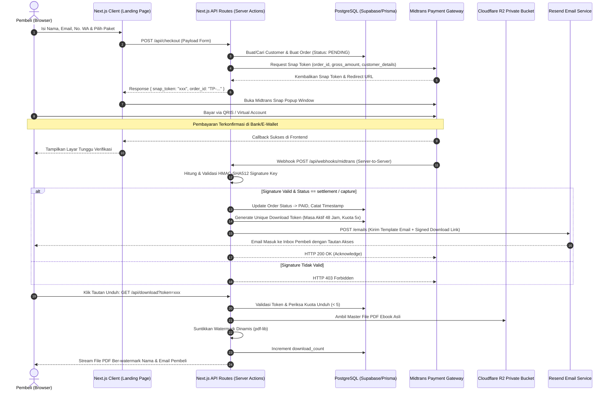

# 04 - Spesifikasi API & Integrasi Layanan Pihak Ketiga
## Produk: Platform E-Commerce Digital "The Prompt - Seni Berbicara dengan AI"

---

## 1. Diagram Alur Transaksi Lengkap (End-to-End Sequence Diagram)



---

## 2. Spesifikasi Endpoint API Internal

### 2.1 `POST /api/checkout`
Membuat pesanan baru dan meminta token pembayaran dari Midtrans.

- **Method:** `POST`
- **Request Body (JSON):**
```json
{
  "name": "Budi Santoso",
  "email": "budi.santoso@example.com",
  "phone": "081234567890",
  "tier": "pro",
  "has_order_bump": true
}
```
- **Response Sukses (`201 Created`):**
```json
{
  "success": true,
  "data": {
    "order_id": "TP-20261015-8942",
    "gross_amount": 208000,
    "snap_token": "75f6e804-9457-4ba4-972f-5154ee4204d0",
    "redirect_url": "https://app.midtrans.com/snap/v2/vtweb/75f6e804-..."
  }
}
```

---

### 2.2 `POST /api/webhooks/midtrans`
Menerima notifikasi otomatis dari Midtrans saat status transaksi berubah.

- **Method:** `POST`
- **Headers:**
  - `Content-Type: application/json`
- **Contoh Payload dari Midtrans:**
```json
{
  "transaction_time": "2026-10-15 07:15:20",
  "transaction_status": "settlement",
  "transaction_id": "83c18b76-43b9-4a0e-9087-73d84f8841a1",
  "status_message": "Midtrans payment notification",
  "status_code": "200",
  "signature_key": "a1b2c3d4e5f6...",
  "payment_type": "qris",
  "order_id": "TP-20261015-8942",
  "gross_amount": "208000.00",
  "fraud_status": "accept",
  "currency": "IDR"
}
```

- **Logika Verifikasi Signature (TypeScript):**
```typescript
import crypto from 'crypto';

export function verifyMidtransSignature(
  orderId: string,
  statusCode: string,
  grossAmount: string,
  serverKey: string,
  incomingSignature: string
): boolean {
  const payload = `${orderId}${statusCode}${grossAmount}${serverKey}`;
  const calculatedSignature = crypto
    .createHash('sha512')
    .update(payload)
    .digest('hex');

  return calculatedSignature === incomingSignature;
}
```

---

### 2.3 `GET /api/download?token=[TOKEN_STRING]`
Menyajikan file PDF ber-watermark secara aman.

- **Query Parameters:**
  - `token` (String, Required): Token unik acak 64 karakter heksadesimal.
- **Logika Validasi & Response:**
  1. Periksa tabel `download_tokens` berdasarkan token.
  2. Cek apakah `new Date() < expires_at` dan `download_count < max_downloads`.
  3. Jika gagal: Kembalikan HTML halaman ramah pengguna berisi tombol minta tautan baru (*Request New Link*).
  4. Jika sukses: Stream PDF dengan Header:
     - `Content-Type: application/pdf`
     - `Content-Disposition: attachment; filename="The-Prompt-Seni-Berbicara-dengan-AI.pdf"`
     - `Cache-Control: private, no-cache, no-store, must-revalidate`

---

## 3. Implementasi Dynamic Watermarking PDF (`pdf-lib`)

Cuplikan kode fungsional untuk menyisipkan identitas pembeli ke setiap halaman dokumen PDF secara instan:

```typescript
import { PDFDocument, rgb, degrees, StandardFonts } from 'pdf-lib';

export async function stampDynamicWatermark(
  originalPdfBuffer: Buffer,
  buyerName: string,
  buyerEmail: string,
  orderNumber: string
): Promise<Uint8Array> {
  const pdfDoc = await PDFDocument.load(originalPdfBuffer);
  const pages = pdfDoc.getPages();
  const font = await pdfDoc.embedFont(StandardFonts.Helvetica);
  const boldFont = await pdfDoc.embedFont(StandardFonts.HelveticaBold);

  const watermarkDiagonalText = `DILISENSIKAN KEPADA: ${buyerName.toUpperCase()} (${buyerEmail})`;
  const footerText = `The Prompt - Seni Berbicara dengan AI | Pembeli Resmi: ${buyerEmail} | Order: #${orderNumber} | Dilarang Menggandakan`;

  for (const page of pages) {
    const { width, height } = page.getSize();

    // 1. Watermark Diagonal Transparan di Tengah Halaman
    page.drawText(watermarkDiagonalText, {
      x: width / 2 - 200,
      y: height / 2,
      size: 14,
      font: boldFont,
      color: rgb(0.7, 0.7, 0.7),
      opacity: 0.16,
      rotate: degrees(45),
    });

    // 2. Footer Permanen di Bawah Setiap Halaman
    page.drawText(footerText, {
      x: 30,
      y: 18,
      size: 7.5,
      font: font,
      color: rgb(0.4, 0.4, 0.4),
      opacity: 0.85,
    });
  }

  return await pdfDoc.save();
}
```

---

## 4. Desain & Integrasi Email Transaksional (Resend API)

Saat transaksi berhasil diverifikasi, sistem memicu pengiriman email dengan *deliverability* tinggi:

- **Pengirim (From):** `Halo dari The Prompt <halo@theprompt.id>`
- **Subjek:** `Akses Ebook Anda: The Prompt - Seni Berbicara dengan AI 🚀 [Order #TP-8942]`
- **Struktur Isi Email:**
  1. Ucapan selamat datang personal (*"Hai Budi Santoso, terima kasih telah berinvestasi pada peningkatan skill AI Anda..."*).
  2. Detail rincian pembayaran (Nomor Order, Paket yang Dibeli, Total Bayar).
  3. **Tombol Utama (CTA):** `[ UNDUH EBOOK & BONUS ANDA ]` yang mengarah ke link download aman.
  4. Instruksi keamanan: Mengingatkan bahwa file berlisensi atas nama pembeli dan link berlaku 48 jam.
  5. Kontak WhatsApp Support jika mengalami kendala membaca file di perangkat e-reader/tablet.
