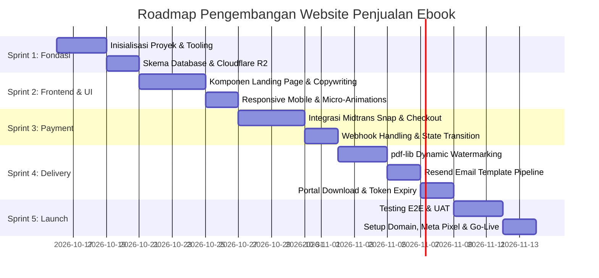

# 05 - Roadmap Implementasi & Pembagian Tugas (Sprints)
## Produk: Platform E-Commerce Digital "The Prompt - Seni Berbicara dengan AI"

---

## 1. Ringkasan Jadwal & Tahapan Pengerjaan

Pengembangan platform dirancang dalam **5 Sprint Kerja** terstruktur dengan total estimasi pengerjaan **3-4 minggu** (atau 1-2 minggu dalam mode intensif):

---

## 2. Rincian Sprint & Daftar Tugas (Task Checklist)

### Sprint 1: Fondasi Proyek, Database & Konfigurasi Cloud
- [ ] **1.1 Inisialisasi Repository:**
  - Setup Next.js 15 App Router dengan TypeScript, Tailwind CSS, ESLint, dan Prettier.
  - Konfigurasi struktur folder standar (`/app`, `/components`, `/lib`, `/server`, `/types`).
- [ ] **1.2 Database & ORM:**
  - Buat instance PostgreSQL pada Supabase / Neon.
  - Tulis skema `schema.prisma` sesuai ERD (Customers, Orders, Transactions, DownloadTokens).
  - Jalankan migrasi awal (`npx prisma migrate dev`).
- [ ] **1.3 Storage & Asset Bucket:**
  - Setup bucket privat pada Cloudflare R2 untuk menyimpan file master Ebook PDF dan materi bonus.
  - Buat kredensial API S3-compatible (`R2_ACCESS_KEY_ID`, `R2_SECRET_ACCESS_KEY`).
- **Definisi Selesai (DoD):** Koneksi database teruji, migrasi berhasil, dan skrip uji upload/download file ke Cloudflare R2 berfungsi normal.

---

### Sprint 2: Landing Page & Desain Konversi Tinggi
- [ ] **2.1 Komponen Hero & Hook:**
  - Implementasi headline, mockup 3D buku interaktif, dan badge garansi.
- [ ] **2.2 Bagian Penjelasan Masalah & Solusi:**
  - Komponen perbandingan "Prompt Asal-asalan vs The Golden Prompt".
  - Preview interaktif daftar bab buku.
- [ ] **2.3 Tabel Pilihan Paket (Pricing Section):**
  - Komponen 3 kartu paket (Starter, Pro, VIP) dengan highlight visual pada paket Pro.
  - Countdown timer promo peluncuran dinamis.
- [ ] **2.4 Komponen Kepercayaan & FAQ:**
  - Galeri testimoni pembaca beta.
  - Accordion FAQ dengan transisi animasi halus.
  - Sticky CTA Bar bawah pada tampilan layar ponsel.
- **Definisi Selesai (DoD):** Seluruh copywriting Indonesia terpasang, lolos uji responsif di iPhone/Android/Desktop, dan skor Google Lighthouse Mobile > 90.

---

### Sprint 3: Modal Checkout & Payment Gateway (Midtrans)
- [ ] **3.1 Modal Checkout 1-Langkah:**
  - Form validasi input (Nama, Email valid, Nomor WhatsApp format Indonesia).
  - Checkbox penawaran instan (*Order Bump* Audio Summary).
- [ ] **3.2 Server Action Checkout (`/api/checkout`):**
  - Membuat record customer & pesanan berstatus `PENDING`.
  - Integrasi SDK Midtrans Node.js / Fetch API untuk generate `snap_token`.
- [ ] **3.3 Popup Midtrans Snap di Frontend:**
  - Menampilkan modal bayar QRIS / Virtual Account langsung tanpa meninggalkan website (*seamless popup*).
  - Event handler callback (`onSuccess`, `onPending`, `onError`, `onClose`).
- **Definisi Selesai (DoD):** Berhasil melakukan transaksi simulasi QRIS & Virtual Account di mode Sandbox Midtrans dari awal hingga muncul pop-up berhasil.

---

### Sprint 4: Otomatisasi Webhook, Watermarking & Pengiriman Email
- [ ] **4.1 Handler Webhook Midtrans (`/api/webhooks/midtrans`):**
  - Validasi SHA-512 signature key resmi Midtrans.
  - Mekanisme idempotency (mencegah duplikasi aksi saat webhook dipanggil berulang kali).
  - Update status order menjadi `PAID` dan buat token unduhan aman.
- [ ] **4.2 Engine Dynamic Watermarking (`pdf-lib`):**
  - Fungsi serverless membaca master PDF dari Cloudflare R2.
  - Menyisipkan teks diagonal transparan nama & email pembeli di setiap lembar PDF.
  - Output PDF terkompresi tanpa membebani memori serverless (> 50MB).
- [ ] **4.3 Pengiriman Email Otomatis (Resend):**
  - Buat template email cantik dan responsif menggunakan `@react-email/components`.
  - Mengirim tautan akses instan ke email pembeli dengan deliverability tinggi.
- [ ] **4.4 Portal Unduhan File (`/api/download`):**
  - Validasi token, kuota unduhan (< 5x), dan tanggal kedaluwarsa (48 jam).
  - Streaming download langsung ke browser pengguna.
- **Definisi Selesai (DoD):** Simulasi pembayaran sukses otomatis menghasilkan PDF ber-watermark nama tester dan email masuk ke inbox dalam < 10 detik.

---

### Sprint 5: Testing, Hardening, Analytics & Go-Live
- [ ] **5.1 End-to-End Testing & Skenario Gagal:**
  - Pengujian alur transaksi happy path dan edge cases (email typo, koneksi terputus saat bayar).
  - Pengujian link kedaluwarsa dan proteksi pembatasan akses.
- [ ] **5.2 Tracking & Analytics:**
  - Pemasangan Meta Pixel (Facebook Ads) + Conversions API (CAPI).
  - Setup Google Tag Manager & Google Analytics 4 (Event: `view_item`, `begin_checkout`, `purchase`).
  - TikTok Pixel untuk campaign video pendek.
- [ ] **5.3 Deployment Production:**
  - Setup custom domain (`theprompt.id` atau sejenisnya) di Vercel/Cloudflare.
  - Beralih dari mode Sandbox ke Kredensial Produksi Midtrans.
  - Final audit keamanan checklist.
- **Definisi Selesai (DoD):** Website aktif di domain utama dengan HTTPS, sistem siap menerima uang riil dari pembeli, dan analytics mencatat event dengan presisi.

---

## 3. Matriks Manajemen Risiko & Mitigasi

| Risiko Potensial | Tingkat Dampak | Rencana Mitigasi |
|---|---|---|
| **Verifikasi Akun Midtrans Production Tertunda** | Tinggi | Ajukan verifikasi dokumen legalitas bisnis sejak Hari ke-1 pengerjaan Sprint 1. Siapkan opsi cadangan Mayar.id atau Xendit. |
| **Email Pengiriman Masuk Folder Spam** | Tinggi | Konfigurasi DNS record SPF, DKIM, dan DMARC secara presisi di domain pengirim melalui dashboard Resend. Sediakan nomor WhatsApp support darurat di halaman konfirmasi. |
| **Konsumsi Memori Tinggi Saat Watermark PDF Besar** | Sedang | Optimasi ukuran file PDF master (kompresi gambar resolusi cetak menjadi 150 DPI digital). Batasi eksekusi `pdf-lib` agar hanya membaca halaman yang relevan secara streaming jika file > 50MB. |
| **Pelanggan Salah Mengetik Alamat Email** | Sedang | Buat validasi konfirmasi input email ganda di form checkout, dan sediakan fitur bagi Admin di dashboard untuk *resend link* ke email baru dengan 1 klik. |
