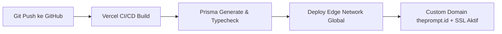

# 07 - Panduan Deployment, Peluncuran & Operasional (SOP)
## Produk: Platform E-Commerce Digital "The Prompt - Seni Berbicara dengan AI"

---

## 1. Panduan Konfigurasi Lingkungan (Environment Variables)

Sebelum melakukan deployment ke Vercel atau server produksi, seluruh variabel lingkungan wajib disiapkan.

### Template Berkas `.env.production`:
```bash
# -------------------------------------------------------------
# KONFIGURASI APLIKASI
# -------------------------------------------------------------
NEXT_PUBLIC_APP_URL="https://theprompt.id"
NODE_ENV="production"

# -------------------------------------------------------------
# DATABASE (PostgreSQL / Supabase / Neon)
# -------------------------------------------------------------
DATABASE_URL="postgresql://postgres:[PASSWORD]@[HOST]:5432/[DB_NAME]?sslmode=require"
DIRECT_URL="postgresql://postgres:[PASSWORD]@[HOST]:5432/[DB_NAME]?sslmode=require"

# -------------------------------------------------------------
# PAYMENT GATEWAY (Midtrans)
# Mode Production (Ganti jika beralih dari Sandbox)
# -------------------------------------------------------------
NEXT_PUBLIC_MIDTRANS_CLIENT_KEY="Mid-client-xxxxxxxxxxxxxxxx"
MIDTRANS_SERVER_KEY="Mid-server-xxxxxxxxxxxxxxxx"
MIDTRANS_IS_PRODUCTION="true"

# -------------------------------------------------------------
# STORAGE ASET DIGITAL (Cloudflare R2)
# -------------------------------------------------------------
R2_ACCOUNT_ID="xxxxxxxxxxxxxxxxxxxxxxxxxxxxxxxx"
R2_ACCESS_KEY_ID="xxxxxxxxxxxxxxxxxxxxxxxxxxxxxxxx"
R2_SECRET_ACCESS_KEY="xxxxxxxxxxxxxxxxxxxxxxxxxxxxxxxx"
R2_BUCKET_NAME="theprompt-digital-assets"
R2_MASTER_PDF_KEY="the-prompt-master-v1.0.pdf"

# -------------------------------------------------------------
# EMAIL TRANSAKSIONAL (Resend)
# -------------------------------------------------------------
RESEND_API_KEY="re_xxxxxxxxxxxxxxxxxxxxxxxxxxxxx"
EMAIL_FROM="The Prompt <halo@theprompt.id>"

# -------------------------------------------------------------
# ANALYTICS & PIXEL TRACKING
# -------------------------------------------------------------
NEXT_PUBLIC_META_PIXEL_ID="123456789012345"
NEXT_PUBLIC_GA_MEASUREMENT_ID="G-XXXXXXXXXX"
NEXT_PUBLIC_TIKTOK_PIXEL_ID="CXXXXXXXXXXXXXXXXXXX"

# -------------------------------------------------------------
# RAHASIA SISTEM & TOKEN UNDUHAN
# -------------------------------------------------------------
DOWNLOAD_TOKEN_SECRET="generate-64-character-random-hex-string"
ADMIN_DASHBOARD_SECRET="secret-passkey-untuk-akses-admin"
```

---

## 2. Langkah-demi-Langkah Deployment ke Vercel



1. **Hubungkan Repository:**
   - Masuk ke dashboard [vercel.com](https://vercel.com).
   - Klik **"Add New Project"** lalu impor repository `theprompt`.
2. **Atur Environment Variables:**
   - Salin seluruh nilai dari daftar variabel di atas ke menu **Settings > Environment Variables** pada project Vercel.
3. **Konfigurasi Build & Output:**
   - Framework Preset: **Next.js**
   - Build Command: `npx prisma generate && next build`
   - Install Command: `npm install`
4. **Setup Custom Domain & DNS:**
   - Buka menu **Settings > Domains** di Vercel, tambahkan `theprompt.id` dan `www.theprompt.id`.
   - Pada panel DNS registrar domain Anda (misal: Cloudflare, Niagahoster, Domainesia), tambahkan record:
     - `A Record` | Host: `@` | Value: `76.76.21.21` (Vercel IP)
     - `CNAME Record` | Host: `www` | Value: `cname.vercel-dns.com`
5. **Konfigurasi Webhook di Portal Midtrans (MAP):**
   - Masuk ke [Midtrans Merchant Administration Portal (MAP)](https://dashboard.midtrans.com).
   - Masuk ke menu **Settings > Configuration**:
     - **Payment Notification URL:** `https://theprompt.id/api/webhooks/midtrans`
     - **Finish Redirect URL:** `https://theprompt.id/order/success`
     - **Unfinish Redirect URL:** `https://theprompt.id/order/pending`
     - **Error Redirect URL:** `https://theprompt.id/order/failed`

---

## 3. Konfigurasi Tracking & Event Ads (Marketing Stack)

Untuk mengoptimalkan konversi iklan berbayar (Meta Ads, TikTok Ads, Google Ads), pasang event berikut:

| Event Name | Kapan Dipicu? | Parameter yang Dikirim |
|---|---|---|
| `PageView` | Setiap pengunjung membuka halaman manapun | `page_path`, `referrer` |
| `ViewContent` | Pengunjung membaca bagian tabel paket / penawaran | `content_name: 'The Prompt Ebook'`, `currency: 'IDR'` |
| `InitiateCheckout` | Pengunjung menekan tombol "Beli Sekarang" & membuka modal | `value: 179000`, `currency: 'IDR'`, `tier: 'pro'` |
| `Purchase` | Pembayaran terkonfirmasi sukses di webhook / layar sukses | `value: 208000`, `currency: 'IDR'`, `transaction_id: 'TP-8942'` |

---

## 4. Standar Operasional Prosedur (SOP) Layanan Pelanggan

Berikut adalah panduan tindakan bagi tim Customer Support (CS) atau pemilik produk saat menghadapi situasi operasional sehari-hari:

### SOP-01: Pembeli Mengaku Sudah Bayar Tapi Belum Menerima Email
1. **Langkah 1 (Cek Folder Spam):** Minta pembeli memeriksa folder *Spam / Junk / Promotions* pada emailnya dan mencari pengirim `halo@theprompt.id`.
2. **Langkah 2 (Cek Kesalahan Ketik Email):** Buka dashboard admin internal (`/admin/orders`) dan cari berdasarkan nama atau nomor WhatsApp pembeli.
   - Sering kali pembeli salah ketik: misalnya `budi@gmail.con` atau `johndoe@gmai.com`.
3. **Langkah 3 (Koreksi & Kirim Ulang):**
   - Jika ditemukan typo, perbarui data email di sistem.
   - Klik tombol **"Kirim Ulang Link Download"** di dashboard admin.
   - Sistem akan otomatis men-trigger pengiriman ulang via Resend API ke alamat yang benar.
4. **Langkah 4 (Backup WhatsApp Manual):** Jika email tetap bermasalah, salin tautan signed download dari admin dan kirimkan langsung via WhatsApp resmi dalam kurun waktu maksimal 15 menit.

---

### SOP-02: Pembeli Mengalami "Link Download Kedaluwarsa" atau "Kuota Habis"
- **Kebijakan:** Link sengaja dibatasi 48 jam dan 5 kali unduh demi proteksi anti-pembajakan.
- **Tindakan:**
  1. Verifikasi bahwa yang meminta adalah pembeli sah (cocokkan nomor order & nomor WhatsApp).
  2. Buka pesanan di dashboard admin, klik tombol **"Reset Kuota & Perpanjang Link 48 Jam"**.
  3. Konfirmasikan ke pembeli agar langsung menyimpan file PDF tersebut ke penyimpanan lokal (Google Drive, laptop, atau tablet) miliknya.

---

### SOP-03: Permintaan Pengembalian Dana (Garansi Uang Kembali 14 Hari)
- **Kebijakan:** Pembeli berhak mengajukan klaim dalam 14 hari kalender sejak tanggal pembelian jika merasa materi tidak memberikan manfaat.
- **Tindakan:**
  1. Catat nomor order, alasan keluhan pembeli (sebagai bahan evaluasi perbaikan materi buku), dan nomor rekening bank/e-wallet pembeli.
  2. Lakukan transfer pengembalian dana 100% penuh.
  3. Ubah status pesanan di database menjadi `REFUNDED`.
  4. Nonaktifkan (*revoke*) token unduhan secara permanen di database agar hak akses dicabut.

---

### SOP-04: Peluncuran Update / Revisi Materi Ebook (Version Release)
- Saat penulis menerbitkan revisi (misalnya penambahan materi AI Agent baru):
  1. Upload file PDF master baru ke Cloudflare R2 dengan nama versi baru (misal: `the-prompt-master-v1.1.pdf`).
  2. Perbarui konfigurasi `R2_MASTER_PDF_KEY` di environment variable.
  3. Jalankan skrip broadcast email otomatis kepada seluruh pembeli paket **Pro** dan **VIP** yang berhak atas *Free Lifetime Updates*, menginfokan pembaruan materi dan memberikan tautan unduh edisi terbaru secara gratis.
